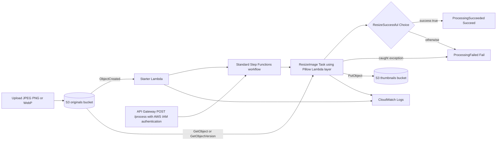

# Serverless Image Processing Pipeline

COMP 200 capstone project — Adebayo mojolaoluwa

This application creates JPEG thumbnails, at most 300 by 300 pixels, from images in a private S3 originals bucket. It preserves aspect ratio, corrects EXIF orientation, and never enlarges small images. A Standard Step Functions workflow runs a resizing Lambda, checks its result, and ends in an explicit success or failure state.

## Architecture



Both entry paths are included. Uploading an original starts processing automatically through a starter Lambda. The API also starts the same workflow directly through an AWS service integration; it does not bypass Step Functions. Separate buckets prevent thumbnail uploads from triggering the pipeline again.

## Repository files

| File | Purpose |
| --- | --- |
| `src/resize_image.py` | Validates an image and creates the thumbnail |
| `src/start_from_s3.py` | Decodes S3 event keys and starts executions |
| `infrastructure/template.json` | Complete CloudFormation deployment |
| `infrastructure/state-machine.asl.json` | Readable workflow source; replace `${ResizeFunctionArn}` for standalone use |
| `requirements-layer.txt` | Pinned Pillow dependency |
| `tools/build_template.py` | Rebuilds the template from the source code |
| `tools/build_layer.py` | Builds a Linux Python 3.12 Pillow layer ZIP |
| `tools/invoke_api.py` | Signs a request to the deployed endpoint with temporary or configured AWS credentials |
| `tests/test_pipeline.py` | Nine local checks with real Pillow and simulated AWS clients |
| `examples/demo-landscape.png` | A 1200 by 800 test image |
| `docs/demo-script.md` | Short demonstration outline |

## Prerequisites

- An AWS account with permission to create S3 buckets, Lambda functions and layers, Step Functions, API Gateway, CloudWatch log groups, and the restricted IAM roles in the template.
- Use one AWS Region for the layer and all resources. Northern Virginia (`us-east-1`) is the suggested Region.
- Python 3.12, pip, and Git for building and publishing the repository. The deployed Lambda runtime is Python 3.12 on x86_64 Amazon Linux 2023.
- For command-line API testing, install boto3 in a virtual environment and authenticate with your own AWS profile or temporary session. Do not commit credentials.

## Build the Lambda layer

From the repository root:

```powershell
python tools/build_layer.py
```

This downloads the pinned official Pillow Linux wheel and creates `build/pillow-layer.zip`, with the required top-level `python/` directory. The Linux wheel uses manylinux 2.28, compatible with Amazon Linux 2023. Do not package Windows Pillow binaries for Lambda.

In AWS Lambda, open **Layers → Create layer**. Name it `capstone-pillow`, upload the ZIP, and select architecture **x86_64** and runtime **Python 3.12**. Copy the complete layer version ARN.

## Deploy

1. Rebuild the template if source code changed: `python tools/build_template.py`.
2. In CloudFormation, choose **Create stack → With new resources** and upload `infrastructure/template.json`.
3. Use stack name `comp200-capstone` and enter the layer version ARN as `PillowLayerArn`.
4. Review the resources and approve IAM creation. The four roles are limited to the two buckets, one workflow, resizing Lambda, and their log groups. No public S3 access is enabled.
5. Wait for `CREATE_COMPLETE`.
6. Open the stack's **Outputs** tab. Record `OriginalsBucket`, `ThumbnailsBucket`, `StateMachineArn`, and `ApiUrl` for your deployment. These values are generated by AWS, not hard-coded in source control.

Bucket names use `<stack>-originals-<account>-<region>` and `<stack>-thumbnails-<account>-<region>`. Keep the stack name short enough for the 63-character S3 name limit. A failed stack caused by an existing name should be investigated before retrying; do not overwrite another project's resources.

## Test automatic processing

1. Upload `examples/demo-landscape.png` to the originals bucket.
2. Open the Step Functions workflow's execution list. The starter creates an execution with an `s3-` name.
3. Open it and verify the green Task, Choice, and Succeed states.
4. Inspect the Task output. It should report `success: true`, original size `[1200,800]`, and thumbnail size `[300,200]`.
5. Open the thumbnails bucket and download the generated `thumbnails/demo-landscape-<digest>.jpg`. Verify its dimensions and appearance.

The CSV labs are separate; this project accepts image contents, not CSV files. S3 may deliver duplicate notifications. A deterministic execution name suppresses duplicate notifications for the same version and sequencer; a new object version is processed separately. A deterministic output key makes retries of the same image/key overwrite the same thumbnail.

## Test API Gateway

Replace the bucket name in this JSON using the CloudFormation output:

```json
{"bucket":"YOUR_ORIGINALS_BUCKET","key":"demo-landscape.png"}
```

In API Gateway, open this project's REST API, select **/process → POST → Test**, paste the JSON into the request body, and run the test. The integration response returns an `executionArn` and `startDate`. Follow that execution in Step Functions and verify the result.

The deployed endpoint is `POST <ApiUrl>` from the Outputs tab. It uses **AWS_IAM** authorization. A normal unsigned browser or curl request is expected to fail; the API is not publicly callable without AWS authorization. For a real signed HTTPS call:

```powershell
python -m pip install boto3
python tools/invoke_api.py --url YOUR_API_URL --bucket YOUR_ORIGINALS_BUCKET --key demo-landscape.png --region us-east-1
```

Your AWS identity needs `execute-api:Invoke` for this API's `demo/POST/process` route. The API integration role separately has only `states:StartExecution` for this workflow. A successful StartExecution response means processing was accepted; it is not proof that resizing finished. Use the returned execution ARN to inspect completion.

To process a specific original version, add `"versionId":"S3_VERSION_ID"`. The automatic path includes the event's version ID, avoiding a race if an object key is overwritten.

## Failure handling and limits

- JPEG, PNG, and WebP only; input limit 10 MiB and 20 million pixels. Animated input uses the first frame.
- Invalid input returns `success: false`, so the Choice routes to Fail. Missing keys and objects also fail clearly.
- Transient Lambda service errors use bounded exponential retries. Unhandled AWS, permission, timeout, or other execution errors use Catch and reach Fail; inspect Task history and logs for the cause.
- Source images and thumbnails stay private and encrypted with S3-managed keys. No card, password, or AWS credential is stored in the repository.
- Logs expire after seven days. The Standard execution history supports troubleshooting.
- This is a small course project, not a production upload service. Large batches need capacity planning and typically a queue or concurrency controls. The API stage has a low request throttle.

## Run local checks

Use an isolated environment with Pillow installed:

```powershell
python -m pip install -r requirements-layer.txt
python -m unittest discover -s tests -v
```

These checks exercise real image transformations but simulate S3 and Step Functions. They do not replace a deployed AWS test. Capture actual AWS results for the submission; do not present local checks as a cloud execution.

## Publish and submit

Commit the source, template, README, tests, and example. Do not commit `build/`, credentials, downloaded dependencies, or temporary evidence. Publish the repository to your own GitHub account and ensure the instructor can access it. Submit the repository URL plus a short video demonstrating an upload, a successful workflow, the thumbnail, and the API trigger. See `docs/demo-script.md`.

## Cleanup and costs

Normal AWS usage charges may apply. After grading, remove the CloudFormation stack when it is no longer needed. Both image buckets have a Retain policy so deleting the stack does not erase your images; empty and delete them separately only when you intend to remove those files. Delete the manually published layer version separately after no function needs it. Do not delete unrelated lab resources.

## Official references

- [Python Lambda layers](https://docs.aws.amazon.com/lambda/latest/dg/python-layers.html)
- [API Gateway calling Step Functions](https://docs.aws.amazon.com/step-functions/latest/dg/tutorial-api-gateway.html)
- [Choice state](https://docs.aws.amazon.com/step-functions/latest/dg/state-choice.html)
- [Step Functions error handling](https://docs.aws.amazon.com/step-functions/latest/dg/concepts-error-handling.html)
- [S3 event structure and URL-encoded keys](https://docs.aws.amazon.com/AmazonS3/latest/userguide/notification-content-structure.html)

